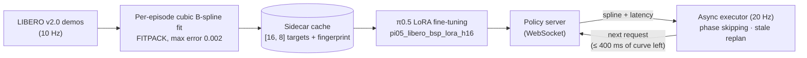

<div align="center">

# openpi05-bsp

### π0.5 with B-spline actions and phase-skipping async execution, benchmarked on LIBERO under random inference latency

<b>English</b> · <a href="./README.zh-CN.md">简体中文</a>


[](LICENSE)
[](https://github.com/Physical-Intelligence/openpi)

</div>

> [!NOTE]
> **This is a research fork of [Physical-Intelligence/openpi](https://github.com/Physical-Intelligence/openpi).** It adds B-spline action targets for π0.5 (following [B-spline Policy](https://b-spline-policy.github.io/), Han, Xiong et al., 2026), async clients with phase skipping and an RTC baseline, and a reproducible random-latency evaluation on LIBERO. Upstream code, the Apache-2.0 license and all credit for openpi stay with Physical Intelligence. The original openpi README now lives in [`docs/UPSTREAM_README.md`](docs/UPSTREAM_README.md).

## 📌 TL;DR

- **Problem:** a π0.5 forward pass takes hundreds of milliseconds. If the robot waits, it stalls. If it keeps moving while the next action chunk is computed, the new chunk arrives partly stale and switching to it causes a jump at the seam.
- **Idea:** train π0.5 to output a continuous cubic **B-spline** instead of discrete action chunks. When a new curve arrives, start executing it at the **phase the robot has already reached** (phase skipping), and drop curves that are completely stale.
- **Result:** coming soon. <!-- TODO(Miles): one headline number from report_v5.md, e.g. success rate and seam jump of bsp_spline_async vs baseline_rtc at Normal(300 ms, 60 ms) latency. -->

## 🎬 Demo

**Demo coming soon:** side-by-side LIBERO rollouts of the four execution modes under the same latency draws.

<!-- GIF slots (one LIBERO episode per mode, same task and trial index, exported from the evaluator MP4s with the "Cumulative inference wait" overlay; square, about 320 px, under 10 MB each):
  docs/media/demo_baseline_sync.gif
  docs/media/demo_baseline_async.gif
  docs/media/demo_baseline_rtc.gif
  docs/media/demo_bsp_spline_async.gif
When all four exist, replace the line above with this table (inside <div align="center">):
| Sync chunking<br/>`baseline_sync` | Async (naive)<br/>`baseline_async` | RTC<br/>`baseline_rtc` | B-spline async (this fork)<br/>`bsp_spline_async` |
|:---:|:---:|:---:|:---:|
|  |  |  |  |
-->

## 📊 Results

**Protocol in one line:** LIBERO (4 suites × 10 tasks × 50 trials = 2,000 episodes per mode), 10k-step LoRA checkpoints, 20 Hz control, and paired random latency drawn from Normal(300 ms, 60 ms) with seed 42, so every mode sees exactly the same delay for the same request.

> [!NOTE]
> **Results coming soon.** The table will report, per mode (`baseline_async`, `baseline_rtc`, `bsp_spline_async`): success rate on each LIBERO suite and the macro average, seam jump (L2), underflow, and latency hiding ratio.

<!-- TODO(Miles): fill from comparison_v5.json / report_v5.md; bold the best value per column; list the code SHA of each run (the BSP run is a post-phase-fix rerun). Do NOT use the 196/200 environment-calibration number here: it is the official pi05_libero checkpoint, not a BSP result. Table header to use:
| Mode | libero_spatial SR | libero_object SR | libero_goal SR | libero_10 SR | Macro SR | Seam jump (L2) | Underflow | Latency hiding ratio |
-->

Because the simulator pauses during underflow, these numbers measure latency hiding, trajectory continuity and throughput. They are not a claim about real-robot dynamics.

## 🧠 Method



Each training target is a cubic B-spline (degree 3) fitted per episode and stored as a `[16, 8]` array: seven control channels plus a knot channel, decoding to 8 actions. Targets are built once into a fingerprinted sidecar cache, so training never refits on the fly. At inference time the client executes the curve at 20 indices/s (`origin_hz` 10 × `speedup` 2) and requests the next curve when 400 ms or less of the current one remains. When the response arrives, the new curve starts at `phase_offset = executed_prefix_steps × 10 × 2 / 20`, so the time the robot kept moving is skipped rather than replayed. A response whose phase offset exceeds the curve's `t_max` is discarded as stale, and the client immediately replans from the latest observation. The baselines share the same request timing: plain async skips the stale prefix of a raw chunk, and RTC adds continuity guidance and splicing.

## 🔀 What changed vs upstream

| Area | Files | Change |
|---|---|---|
| B-spline targets | `src/openpi/training/bsp.py`, `bsp_dataset.py` | New: FITPACK fitting (port of bspline-policy, MIT), sidecar cache, dataset adapter |
| Training configs | `src/openpi/training/config.py` | Added `pi05_libero_{baseline,bsp}_h16` and `pi05_libero_{baseline,bsp}_lora_h16` |
| Data prep | `scripts/prepare_libero_bsp.py` | New: `download` / `build` / `verify` modes for LIBERO v2.0 and the BSP cache |
| Async clients | `packages/openpi-client/src/openpi_client/{bsp_spline,async_inference,rtc,latency_sampling}.py` | New: spline executor with phase skipping, async scheduler, RTC client, deterministic latency sampler |
| Evaluation | `examples/libero/main_v5.py`, `openpi_client/libero_{control,eval,report,video_timing}_v5.py` | New: schema-v5 evaluator, 40 FPS video with wait overlay, reporters |
| Comparison | `scripts/compare_libero_latency_v5.py`, `scripts/compare_libero_sync_v5.py` | New: three-mode async report and two-mode sync report |
| Docs | `docs/pi05_libero_latency_experiment_v5.md`, `docs/pi05_libero_bsp_phase1_server.md`, `docs/pi05_libero_bsp_server_state.md` | New: protocol and runbooks (in Chinese) |

## 🚀 Quick start

Set up the environment as described in [`docs/UPSTREAM_README.md`](docs/UPSTREAM_README.md) (uv, Python 3.11) and [`examples/libero/README.md`](examples/libero/README.md). LIBERO runs in a separate Python 3.8 environment.

```bash
git clone --recurse-submodules https://github.com/Siyuan-Xue/openpi05-bsp.git
cd openpi05-bsp

# 1. Serve a fine-tuned checkpoint
python scripts/serve_policy.py --env LIBERO policy:checkpoint \
  --policy.config pi05_libero_bsp_lora_h16 --policy.dir <CHECKPOINT_DIR>/10000

# 2. Evaluate one mode under paired random latency (LIBERO Python env)
python examples/libero/main_v5.py \
  --args.execution-mode bsp_spline_async \
  --args.task-suite-name all --args.num-trials-per-task 50 \
  --args.control-freq 20 --args.video-fps 40 --args.video-show-inference-waits \
  --args.bsp-cache-hash <SIDECAR_SHA256> \
  --args.bsp-cache-manifest-fingerprint <MANIFEST_FINGERPRINT>
```

`--args.execution-mode` takes `baseline_async`, `baseline_rtc` or `bsp_spline_async`. For baseline modes, serve `pi05_libero_baseline_lora_h16` and omit the two BSP arguments.

<!-- TODO(Miles): confirm these commands end to end; the runbooks set PYTHONPATH, PYTHONDONTWRITEBYTECODE=1 and PYTHONNOUSERSITE=1 explicitly. Fine-tuned checkpoints are not published; say so or link them if you are cleared to share. -->

## 🔁 Reproducing results

All runs use seed 42, effective batch 256 (micro-batch 64), no EMA, and 10,000 steps, with fixed checkpoints at 0k/1k/2k/5k/10k and no best-checkpoint picking.

```bash
# Build and verify the B-spline sidecar (LIBERO v2.0)
python scripts/prepare_libero_bsp.py --mode build --dataset-root <LIBERO_DIR> \
  --cache-path <BSP_CACHE>.npz --repo-id physical-intelligence/libero --revision v2.0 --action-key actions
python scripts/prepare_libero_bsp.py --mode verify --dataset-root <LIBERO_DIR> \
  --cache-path <BSP_CACHE>.npz --diagnostics-path <BSP_VERIFY>.json \
  --repo-id physical-intelligence/libero --revision v2.0 --action-key actions

# Train the BSP arm (baseline: pi05_libero_baseline_lora_h16, same flags, no --data.bsp-cache-path)
python scripts/train.py pi05_libero_bsp_lora_h16 --exp-name <EXP> --seed 42 \
  --batch-size 256 --micro-batch-size 64 --num-train-steps 10000 --save-interval 1000 \
  --ema-decay None --data.lerobot-root <LIBERO_DIR> --data.bsp-cache-path <BSP_CACHE>.npz

# Compare the two synchronous runs
python scripts/compare_libero_sync_v5.py <BASELINE_SYNC_RUN> <BSP_SPLINE_SYNC_RUN> --output-dir <NEW_EMPTY_DIR>
```

Norm stats (`scripts/compute_norm_stats.py`), the three-mode async comparison (`scripts/compare_libero_latency_v5.py`) and every server gate are documented step by step in [`docs/pi05_libero_bsp_phase1_server.md`](docs/pi05_libero_bsp_phase1_server.md) and [`docs/pi05_libero_latency_experiment_v5.md`](docs/pi05_libero_latency_experiment_v5.md).

## 📚 Citation

<!-- TODO(Miles): add a BibTeX entry for this work if you write it up. -->
If you use this fork, please cite the works it builds on:

```bibtex
@article{han2026b,
  title={B-spline Policy: Accelerating Manipulation Policies via B-spline Action Representations},
  author={Han, Xiaoshen and Xiong, Haoyu and Chen, Haonan and Liu, Chaoqi and Torralba, Antonio and Zhu, Yuke and Du, Yilun},
  journal={arXiv preprint arXiv:2607.09648},
  year={2026}
}

@misc{black2025realtimeexecutionactionchunking,
  title={Real-Time Execution of Action Chunking Flow Policies},
  author={Kevin Black and Manuel Y. Galliker and Sergey Levine},
  year={2025},
  eprint={2506.07339},
  archivePrefix={arXiv},
  primaryClass={cs.RO},
  url={https://arxiv.org/abs/2506.07339}
}

@article{black2025pi05,
  title={$\pi_{0.5}$: a Vision-Language-Action Model with Open-World Generalization},
  author={Black, Kevin and Brown, Noah and Darpinian, James and Dhabalia, Karan and Driess, Danny and Esmail, Adnan and Equi, Michael and Finn, Chelsea and Fusai, Niccolo and Galliker, Manuel Y. and Ghosh, Dibya and Groom, Lachy and Hausman, Karol and Ichter, Brian and Jakubczak, Szymon and Jones, Tim and Ke, Liyiming and LeBlanc, Devin and Levine, Sergey and Li-Bell, Adrian and Mothukuri, Mohith and Nair, Suraj and Pertsch, Karl and Ren, Allen Z. and Shi, Lucy Xiaoyang and Smith, Laura and Springenberg, Jost Tobias and Stachowicz, Kyle and Tanner, James and Vuong, Quan and Walke, Homer and Walling, Anna and Wang, Haohuan and Yu, Lili and Zhilinsky, Ury},
  journal={arXiv preprint arXiv:2504.16054},
  year={2025}
}
```

## 🙏 Acknowledgements

- [Physical Intelligence / openpi](https://github.com/Physical-Intelligence/openpi): π0.5 model, training and serving code (Apache-2.0).
- [B-spline Policy](https://github.com/B-spline-policy/bspline-policy) by Han, Xiong et al.: the B-spline action representation. `src/openpi/training/bsp.py` is ported from revision `61ed5f42fced971d50a89b46417493790876ccd1` (MIT, © 2026 Haoyu Xiong).
- Real-Time Chunking by Black, Galliker and Levine: the RTC baseline.
- [LIBERO](https://github.com/Lifelong-Robot-Learning/LIBERO): benchmark, pinned as the `third_party/libero` submodule.

## 📄 License

Code is licensed under the **Apache License 2.0**, inherited from upstream openpi; see [`LICENSE`](LICENSE). Fork changes by Miles Xue (Siyuan Xue) are released under the same license. π0.5 builds on PaliGemma, so model weights and checkpoints derived from Gemma are additionally subject to the **Gemma Terms of Use** in [`LICENSE_GEMMA.txt`](LICENSE_GEMMA.txt). The ported B-spline fitting code (`src/openpi/training/bsp.py`) keeps its original MIT notice in the file header.
