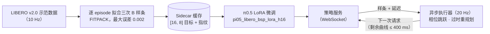

<!-- 术语表（修改中文版前请先对照）：action chunk=动作块（action chunk）；B-spline=B 样条（B-spline）；phase skipping=相位跳跃（phase skipping）；policy=策略（policy）；inference latency=推理延迟；async execution=异步执行；seam=衔接处跳变（seam jump）；underflow=动作耗尽（underflow）；latency hiding ratio=延迟隐藏率；success rate=成功率（表头保留 SR）；fork=分支（fork）；upstream=上游；checkpoint 保持英文；π0.5、openpi、LIBERO、RTC、LoRA、JAX、FITPACK、WebSocket 等名称不翻译。人称统一用“你”，引号统一用「」。BibTeX、命令与表头中的指标名不翻译。 -->

<div align="center">

# openpi05-bsp

### 让 π0.5 输出 B 样条轨迹并以相位跳跃异步执行，在 LIBERO 随机推理延迟下对比评测

<a href="./README.md">English</a> · <b>简体中文</b>


[](LICENSE)
[](https://github.com/Physical-Intelligence/openpi)

</div>

> [!NOTE]
> **这是 [Physical-Intelligence/openpi](https://github.com/Physical-Intelligence/openpi) 的研究分支（fork）。** 本分支为 π0.5 增加了 B 样条动作目标（参考 [B-spline Policy](https://b-spline-policy.github.io/)，Han、Xiong 等，2026），实现了带相位跳跃的异步客户端和 RTC 基线，并提供可复现的 LIBERO 随机延迟评测。上游代码、Apache-2.0 许可证以及 openpi 的全部署名归 Physical Intelligence 所有。原 openpi README 已移至 [`docs/UPSTREAM_README.md`](docs/UPSTREAM_README.md)。

## 📌 概述

- **问题**：π0.5 每次推理要花几百毫秒。机器人等推理结果就会停顿；边动边算的话，新的动作块到达时已部分过时，切换时在衔接处产生跳变。
- **思路**：让 π0.5 直接输出连续的三次 **B 样条**，而不是离散动作块。新曲线一到，就从机器人**已经走到的相位**开始执行（相位跳跃），完全过时的曲线则直接丢弃。
- **结果**：即将公布。<!-- TODO(Miles)：从 report_v5.md 摘一个核心数字，例如在 Normal(300 ms, 60 ms) 延迟下 bsp_spline_async 相对 baseline_rtc 的成功率和衔接跳变。 -->

## 🎬 效果演示

**演示即将上线**：四种执行模式在相同延迟采样下的 LIBERO 并排对比。

<!-- GIF 位（每种模式导出同一任务、同一 trial 的一个 LIBERO episode，取自评测生成的 MP4，带「Cumulative inference wait」叠字；正方形，约 320 px，每个小于 10 MB）：
  docs/media/demo_baseline_sync.gif
  docs/media/demo_baseline_async.gif
  docs/media/demo_baseline_rtc.gif
  docs/media/demo_bsp_spline_async.gif
四个文件齐了以后，把上面那一行换成下面的表格（放在 <div align="center"> 里）：
| 同步分块<br/>`baseline_sync` | 朴素异步<br/>`baseline_async` | RTC<br/>`baseline_rtc` | B 样条异步（本分支）<br/>`bsp_spline_async` |
|:---:|:---:|:---:|:---:|
|  |  |  |  |
-->

## 📊 实验结果

**一句话说明协议**：在 LIBERO 上评测（4 个套件 × 10 个任务 × 50 次 = 每种模式 2,000 个 episode），使用 10k 步 LoRA checkpoint，控制频率 20 Hz；延迟从 Normal(300 ms, 60 ms) 中按种子 42 配对采样，同一请求在每种模式下的延迟完全相同。

> [!NOTE]
> **实验结果即将公布。** 届时会按模式（`baseline_async`、`baseline_rtc`、`bsp_spline_async`）列出：各 LIBERO 套件的成功率及宏平均、衔接跳变（L2）、动作耗尽次数和延迟隐藏率。

<!-- TODO(Miles)：从 comparison_v5.json / report_v5.md 填入数字，每列最优值加粗，并注明每组运行的 code SHA（BSP 组是相位修复后的重跑）。不要用 196/200 的环境校准结果：那是官方 pi05_libero checkpoint，不是 BSP 的结果。表头沿用：
| Mode | libero_spatial SR | libero_object SR | libero_goal SR | libero_10 SR | Macro SR | Seam jump (L2) | Underflow | Latency hiding ratio |
-->

动作耗尽（underflow）时仿真会暂停，所以这些数字反映的是延迟隐藏、轨迹衔接和吞吐量，不代表真机动力学上的改进。

## 🧠 方法



每个训练目标都是按 episode 拟合的三次 B 样条，存成 `[16, 8]` 数组：7 个控制通道加 1 个节点（knot）通道，可解码为 8 个动作。目标只在 sidecar 缓存中构建一次并带有指纹，训练时不会临时重新拟合。推理时，客户端以每秒 20 个索引（`origin_hz` 10 × `speedup` 2）执行曲线，当前曲线剩余不超过 400 ms 时请求下一条。响应到达后，新曲线从 `phase_offset = executed_prefix_steps × 10 × 2 / 20` 处开始，机器人在等待期间已经走过的部分直接跳过、不再重放。若相位偏移超过曲线的 `t_max`，响应视为过时并丢弃，客户端立即用最新观测重新规划。基线使用相同的请求时机：朴素异步跳过原始动作块中已过时的前缀，RTC 则额外加入连续性引导并拼接新旧动作块。

## 🔀 相对上游的改动

| 模块 | 文件 | 改动 |
|---|---|---|
| B 样条目标 | `src/openpi/training/bsp.py`、`bsp_dataset.py` | 新增：FITPACK 拟合（移植自 bspline-policy，MIT）、sidecar 缓存、数据集适配 |
| 训练配置 | `src/openpi/training/config.py` | 新增 `pi05_libero_{baseline,bsp}_h16` 和 `pi05_libero_{baseline,bsp}_lora_h16` |
| 数据准备 | `scripts/prepare_libero_bsp.py` | 新增：针对 LIBERO v2.0 和 BSP 缓存的 `download` / `build` / `verify` 三种模式 |
| 异步客户端 | `packages/openpi-client/src/openpi_client/{bsp_spline,async_inference,rtc,latency_sampling}.py` | 新增：带相位跳跃的样条执行器、异步调度器、RTC 客户端、确定性延迟采样器 |
| 评测 | `examples/libero/main_v5.py`、`openpi_client/libero_{control,eval,report,video_timing}_v5.py` | 新增：schema-v5 评测器、带等待时间叠字的 40 FPS 视频、报告生成 |
| 对比 | `scripts/compare_libero_latency_v5.py`、`scripts/compare_libero_sync_v5.py` | 新增：三模式异步报告和两模式同步报告 |
| 文档 | `docs/pi05_libero_latency_experiment_v5.md`、`docs/pi05_libero_bsp_phase1_server.md`、`docs/pi05_libero_bsp_server_state.md` | 新增：实验协议与服务器操作手册（中文） |

## 🚀 快速开始

环境搭建参考 [`docs/UPSTREAM_README.md`](docs/UPSTREAM_README.md)（uv，Python 3.11）和 [`examples/libero/README.md`](examples/libero/README.md)；LIBERO 运行在独立的 Python 3.8 环境中。

> 国内网络提示：在国内服务器上运行时，可以设置 `HF_ENDPOINT=https://hf-mirror.com` 下载 LIBERO 数据集，并把 pip 指向国内 PyPI 镜像（本项目的服务器手册就是这样配置的）。依赖版本仍以仓库的锁定文件为准。

```bash
git clone --recurse-submodules https://github.com/Siyuan-Xue/openpi05-bsp.git
cd openpi05-bsp

# 1. Serve a fine-tuned checkpoint
python scripts/serve_policy.py --env LIBERO policy:checkpoint \
  --policy.config pi05_libero_bsp_lora_h16 --policy.dir <CHECKPOINT_DIR>/10000

# 2. Evaluate one mode under paired random latency (LIBERO Python env)
python examples/libero/main_v5.py \
  --args.execution-mode bsp_spline_async \
  --args.task-suite-name all --args.num-trials-per-task 50 \
  --args.control-freq 20 --args.video-fps 40 --args.video-show-inference-waits \
  --args.bsp-cache-hash <SIDECAR_SHA256> \
  --args.bsp-cache-manifest-fingerprint <MANIFEST_FINGERPRINT>
```

`--args.execution-mode` 可取 `baseline_async`、`baseline_rtc` 或 `bsp_spline_async`。评测基线模式时，服务端改用 `pi05_libero_baseline_lora_h16`，并省略两个 BSP 参数。

<!-- TODO(Miles)：端到端确认上述命令；操作手册中显式设置了 PYTHONPATH、PYTHONDONTWRITEBYTECODE=1 和 PYTHONNOUSERSITE=1。微调后的 checkpoint 尚未公开：要么说明这一点，要么在确认可以分享后附上链接。 -->

## 🔁 复现实验

所有运行都使用种子 42、有效 batch 256（micro-batch 64）、不使用 EMA、训练 10,000 步，固定在 0k/1k/2k/5k/10k 保存 checkpoint，不挑选最优 checkpoint。

```bash
# Build and verify the B-spline sidecar (LIBERO v2.0)
python scripts/prepare_libero_bsp.py --mode build --dataset-root <LIBERO_DIR> \
  --cache-path <BSP_CACHE>.npz --repo-id physical-intelligence/libero --revision v2.0 --action-key actions
python scripts/prepare_libero_bsp.py --mode verify --dataset-root <LIBERO_DIR> \
  --cache-path <BSP_CACHE>.npz --diagnostics-path <BSP_VERIFY>.json \
  --repo-id physical-intelligence/libero --revision v2.0 --action-key actions

# Train the BSP arm (baseline: pi05_libero_baseline_lora_h16, same flags, no --data.bsp-cache-path)
python scripts/train.py pi05_libero_bsp_lora_h16 --exp-name <EXP> --seed 42 \
  --batch-size 256 --micro-batch-size 64 --num-train-steps 10000 --save-interval 1000 \
  --ema-decay None --data.lerobot-root <LIBERO_DIR> --data.bsp-cache-path <BSP_CACHE>.npz

# Compare the two synchronous runs
python scripts/compare_libero_sync_v5.py <BASELINE_SYNC_RUN> <BSP_SPLINE_SYNC_RUN> --output-dir <NEW_EMPTY_DIR>
```

归一化统计（`scripts/compute_norm_stats.py`）、三模式异步对比（`scripts/compare_libero_latency_v5.py`）以及每一道服务器检查，都在 [`docs/pi05_libero_bsp_phase1_server.md`](docs/pi05_libero_bsp_phase1_server.md) 和 [`docs/pi05_libero_latency_experiment_v5.md`](docs/pi05_libero_latency_experiment_v5.md) 中有逐步说明。

## 📚 引用

<!-- TODO(Miles)：如果你把这项工作写成报告或论文，在此补充对应的 BibTeX。 -->
如果本分支对你有帮助，请引用它所基于的工作：

```bibtex
@article{han2026b,
  title={B-spline Policy: Accelerating Manipulation Policies via B-spline Action Representations},
  author={Han, Xiaoshen and Xiong, Haoyu and Chen, Haonan and Liu, Chaoqi and Torralba, Antonio and Zhu, Yuke and Du, Yilun},
  journal={arXiv preprint arXiv:2607.09648},
  year={2026}
}

@misc{black2025realtimeexecutionactionchunking,
  title={Real-Time Execution of Action Chunking Flow Policies},
  author={Kevin Black and Manuel Y. Galliker and Sergey Levine},
  year={2025},
  eprint={2506.07339},
  archivePrefix={arXiv},
  primaryClass={cs.RO},
  url={https://arxiv.org/abs/2506.07339}
}

@article{black2025pi05,
  title={$\pi_{0.5}$: a Vision-Language-Action Model with Open-World Generalization},
  author={Black, Kevin and Brown, Noah and Darpinian, James and Dhabalia, Karan and Driess, Danny and Esmail, Adnan and Equi, Michael and Finn, Chelsea and Fusai, Niccolo and Galliker, Manuel Y. and Ghosh, Dibya and Groom, Lachy and Hausman, Karol and Ichter, Brian and Jakubczak, Szymon and Jones, Tim and Ke, Liyiming and LeBlanc, Devin and Levine, Sergey and Li-Bell, Adrian and Mothukuri, Mohith and Nair, Suraj and Pertsch, Karl and Ren, Allen Z. and Shi, Lucy Xiaoyang and Smith, Laura and Springenberg, Jost Tobias and Stachowicz, Kyle and Tanner, James and Vuong, Quan and Walke, Homer and Walling, Anna and Wang, Haohuan and Yu, Lili and Zhilinsky, Ury},
  journal={arXiv preprint arXiv:2504.16054},
  year={2025}
}
```

## 🙏 致谢

- [Physical Intelligence / openpi](https://github.com/Physical-Intelligence/openpi)：π0.5 模型及训练、服务代码（Apache-2.0）。
- [B-spline Policy](https://github.com/B-spline-policy/bspline-policy)（Han、Xiong 等）：B 样条动作表示。`src/openpi/training/bsp.py` 移植自其 `61ed5f42fced971d50a89b46417493790876ccd1` 版本（MIT，© 2026 Haoyu Xiong）。
- Real-Time Chunking（Black、Galliker、Levine）：RTC 基线。
- [LIBERO](https://github.com/Lifelong-Robot-Learning/LIBERO)：评测基准，以 `third_party/libero` 子模块固定版本。

## 📄 许可证

代码沿用上游 openpi 的 **Apache License 2.0**，见 [`LICENSE`](LICENSE)。Miles Xue（Siyuan Xue）在本分支中的改动以同一许可证发布。π0.5 基于 PaliGemma，因此源自 Gemma 的模型权重和 checkpoint 还须遵守 [`LICENSE_GEMMA.txt`](LICENSE_GEMMA.txt) 中的 **Gemma Terms of Use**。移植的 B 样条拟合代码（`src/openpi/training/bsp.py`）在文件头保留了原有的 MIT 声明。
